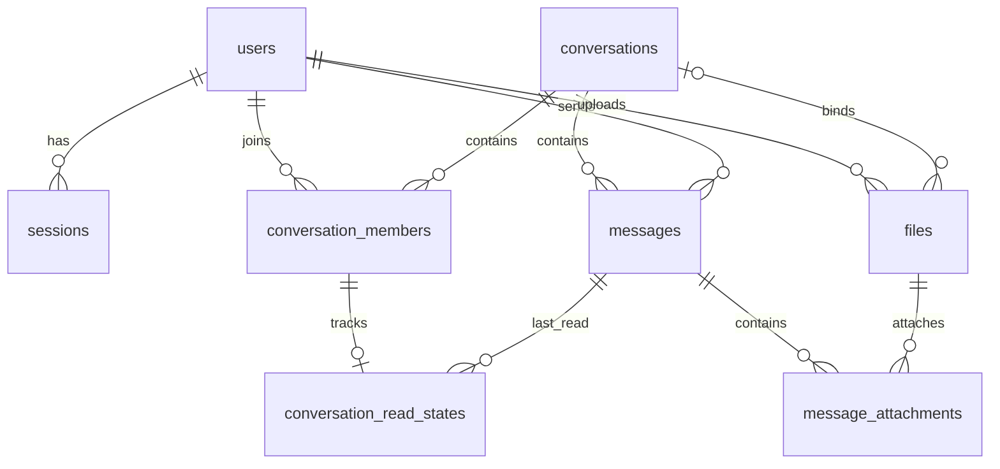

# Schema chat

Schema cho phạm vi API đã thống nhất; entity chỉ mô hình hóa dữ liệu.
Auth/session, hồ sơ, tìm kiếm user, lookup DIRECT, tạo GROUP, danh sách/chi tiết/cập nhật
hội thoại, danh sách/thêm/xóa thành viên và upload/download file có phân quyền đã được triển khai;
gửi tin qua WebSocket, typing và presence đã được triển khai. Lịch sử cursor, mốc đọc HTTP
chỉ tiến và READ_RECEIPT sau commit cũng đã được triển khai.

| Bảng | Entity | Nội dung |
| --- | --- | --- |
| users | UserEntity | Username, password hash, hồ sơ, avatar, lastSeen |
| sessions | SessionEntity | Hash token, user, hạn phiên, thu hồi |
| conversations | ConversationEntity | DIRECT/GROUP, cặp user hoặc owner/name/avatar nhóm |
| conversation_members | ConversationMemberEntity | Thành viên, role, thời điểm tham gia/rời |
| conversation_read_states | ConversationReadStateEntity | Mốc đã đọc của một membership; chưa đọc thì chưa có dòng |
| messages | MessageEntity | Hội thoại, người gửi, clientMessageId, nội dung |
| files | FileEntity | Người upload, tên, MIME, dung lượng, storageKey, hội thoại đã gắn |
| message_attachments | MessageAttachmentEntity | Liên kết tin với file, thứ tự hiển thị |

`flyway_schema_history` là bảng kỹ thuật của Flyway, không có entity nghiệp vụ.



Quan hệ avatar và owner/cặp user cũng có foreign key trong DB;
sơ đồ trên lược bớt chúng để dễ đọc.
Entity lưu FK ID theo convention, không dựng graph `@OneToMany`.

## Chuẩn hóa 3NF — V4

V4 giữ nguyên lịch sử V1–V3, chuyển mốc đọc hiện có sang bảng mới trước khi bỏ cột cũ.
Không xóa tin, file, thành viên hoặc liên kết đính kèm.

- Bỏ `message_attachments.conversation_id`: `message_id` đã xác định hội thoại,
  nhưng không phải siêu khóa của attachment (một tin có nhiều file).
- Tách `conversation_members.last_read_message_id` sang `conversation_read_states`:
  với mốc đọc có giá trị, `last_read_message_id` xác định hội thoại nhưng không xác định
  thành viên (nhiều thành viên có thể đọc cùng tin). Bảng mới dùng `member_id` làm khóa chính,
  không lặp conversation/user. Giữ nguyên thời gian audit của dòng thành viên khi chuyển.
- Các giá trị tính toán như memberCount, unreadCount, lastMessage, downloadUrl và presence
  không lưu lặp trong bảng.

Các khóa ứng viên và phụ thuộc hàm theo nghiệp vụ hiện tại:

| Bảng | Khóa ứng viên | Thuộc tính phụ thuộc vào khóa |
| --- | --- | --- |
| users | id; username | password_hash, full_name, avatar_file_id, last_seen, audit |
| sessions | id; token_hash | user_id, created_at, expires_at, revoked_at |
| conversations | id | type, name, owner_id, avatar_file_id, cặp DIRECT, audit |
| conversation_members | id; (conversation_id, user_id) | role, joined_at, left_at, audit |
| conversation_read_states | member_id | last_read_message_id, audit |
| messages | id; (sender_id, client_message_id) | conversation_id, content, audit |
| files | id; storage_key | uploader_id, conversation_id, name, content_type, size, audit |
| message_attachments | id; (message_id, file_id); (message_id, position) | các thuộc tính còn lại, audit |

Mỗi thuộc tính chứa một giá trị; thuộc tính không khóa phụ thuộc đầy đủ vào khóa,
không có phụ thuộc bắc cầu qua thuộc tính không phải siêu khóa trong từng bảng theo các
phụ thuộc nghiệp vụ trên. Cặp DIRECT là unique có điều kiện cho DIRECT, không phải khóa
ứng viên của toàn bộ bảng vì GROUP để hai cột này NULL.
Tên người, tên file, MIME hoặc role không được coi là duy nhất.
OWNER và owner_id phải nhất quán ở service; đó là ràng buộc liên bảng, không phải lý do
để bỏ FK hay thêm bảng riêng cho mỗi enum.

3NF không có nghĩa ít bảng hoặc ít đường nối. Các quan hệ user, hội thoại, tin nhắn,
file và thành viên vẫn cần FK để tránh dữ liệu mồ côi.

## ID, audit và enum

- UUID lưu BINARY(16); API serialize UUID string.
- Ngoài session, entity kế thừa BaseEntity cho createdAt/updatedAt, tự điền bằng JPA Auditing.
- Session giữ thời gian vòng đời riêng.
- `ConversationTypeEnum`: `'DIRECT' | 'GROUP'`.
- `MemberRoleEnum`: `'OWNER' | 'MEMBER'`.
- Enum lưu VARCHAR và CHECK tại DB, không lưu ordinal.
- ONLINE/OFFLINE là presence runtime; không có bảng enum hoặc entity presence.
- File không có cột binary payload; `downloadUrl` được tạo từ API, không lưu URL deployment.

## Ràng buộc DB

- DIRECT lưu hai UUID theo thứ tự byte tăng dần; unique cặp UUID chống tạo trùng khi hai bên gửi đồng thời.
- GROUP có owner/name; DIRECT không có owner/name/avatar riêng.
- Một dòng member cho mỗi cặp conversation/user. `left_at IS NULL` là đang tham gia.
  Khi tái tham gia sẽ cập nhật dòng đó; schema chưa lưu lịch sử nhiều lần vào/ra.
- Unique senderId + clientMessageId chống lưu trùng retry, kể cả request đổi conversation.
- Index conversationId + createdAt + id phục vụ lịch sử theo cursor.
- Mốc lastReadMessageId nằm ở bảng read state; FK riêng tới member và message.
  Trigger INSERT/UPDATE kiểm tra tin cùng hội thoại với member.
- File có conversationId nullable khi mới upload. Khi gắn tin, phải bind vào hội thoại trước.
- Attachment dùng FK riêng tới message và file; trigger INSERT/UPDATE kiểm tra cùng hội thoại.
  Một file có thể được gửi nhiều lần trong cùng hội thoại, không chuyển qua hội thoại khác.
- Trigger khóa dòng cha khi kiểm tra; chặn đổi hội thoại của message/member, đổi user của member,
  hoặc đổi/xóa binding của file đã gắn. File chưa bind vẫn được bind lần đầu.
  Các trigger giữ ràng buộc liên bảng sau khi bỏ cột lặp; không thay thế phân quyền ở service.
  Tài khoản chạy Flyway cần quyền CREATE TRIGGER trên schema Chat.
- Unique message/file và message/position; position không âm.
- Avatar user/nhóm có FK đến files. Khi cập nhật avatar user, service chỉ nhận file
  `image/*` do chính user upload và chưa gắn vào hội thoại.
- Không cascade delete; chưa có API xóa user/hội thoại/tin trong phạm vi hiện tại.

## Những quy tắc cần service/transaction

DB không thể thay thế kiểm tra nghiệp vụ:

- Chỉ tạo DIRECT khi có tin đầu; transaction tạo conversation + members + message.
- Người gửi phải là thành viên hiện tại; owner nhóm phải có membership OWNER duy nhất.
- Tin có content hoặc file; giới hạn 20 MiB/file, MIME, quyền uploader.
- Mốc đọc chỉ tiến; so sánh theo createdAt/id, không theo UUID đơn thuần.
- Thêm/xóa/rejoin thành viên, tính memberCount/unreadCount, lastMessage và presence.
- Retry khác payload trả CONFLICT; unique key chỉ chống insert trùng.
- Khi bind file đồng thời phải khóa/UPDATE có điều kiện. Method entity không tự bảo vệ race.

Không có bảng riêng cho pagination, ACK, ERROR, TYPING hoặc các response DTO.

## Xem trong MySQL Workbench

Refresh Schemas → `chat` → Tables. Xem quan hệ bằng Database → Reverse Engineer
và chọn riêng schema `chat`.

UUID BINARY(16) có thể xem dạng text:

```sql
SELECT BIN_TO_UUID(id) AS id, username, full_name FROM chat.users;
SELECT BIN_TO_UUID(id) AS id, type, name FROM chat.conversations;
SHOW CREATE TABLE chat.message_attachments;
```

Không có seed user/tin nhắn mẫu. DB mới có 8 bảng nghiệp vụ và bảng lịch sử Flyway.
DB nâng cấp giữ dữ liệu cũ; refresh hoặc reverse engineer lại để thấy schema V4.
